# 🏈 SportsAgentic — Universal College Football Agent & MCP Server

An open-source, high-performance **College Football (CFB) Agent & MCP Server** written in Go.

Query live game scores, weekly matchups, full team schedules, and national rankings across **any AI agent ecosystem**:
- 🟣 **Claude** (Claude Desktop & Claude Code via native MCP)
- 🟢 **OpenAI & ChatGPT** (Custom GPT Actions via OpenAPI & Assistants API)
- 🔷 **Delta** (Pre-packaged Delta Skill `/cfb`)
- 💻 **Cursor, Zed & Windsurf** (Native IDE MCP)
- 🐳 **Docker Ready** (One-command setup with zero Go/Python installation)

---

## 🏗️ Architecture



SportsAgentic is a high-performance Model Context Protocol (MCP) server written in Go 1.23:
- **Multi-Transport Engine**: Supports `stdio` (for Claude Desktop, Cursor, Zed, Windsurf) and HTTP/SSE on `:8080/sse` and `:8080/message` (for `SportsAgenticAgent`, Delta skills, and network clients).
- **Tool Dispatcher**: Exposes three core MCP tools:
  - `get_cfb_scores`: fetches live and historical scores by season, week, team, or date with mandatory parameter enforcement (preventing unbounded nationwide season queries).
  - `get_team_schedule`: retrieves full season game schedules for a specified team.
  - `get_cfb_rankings`: retrieves national AP Top 25 and College Football Playoff (CFP) rankings.
- **Smart Entity Resolution** (`pkg/resolver/team.go`): Normalizes informal aliases, abbreviations, and nicknames (e.g. "Bama" ➔ "Alabama", "CSU" ➔ "Colorado State", "Ole Miss" ➔ "Ole Miss") into official CFBD school identifiers.
- **CFBD Client** (`pkg/cfbd/client.go`): Communicates with the College Football Data REST API with Bearer token authentication.

---

## ⚡ Quickstart with Docker (Easiest)

You don't need Go or Python installed if you have Docker.

```bash
git clone https://github.com/tmonteith/SportsAgentic.git
cd SportsAgentic

# 1. Create your .env file
cp .env.example .env
# Edit .env and paste your free key from https://collegefootballdata.com/key

# 2. Start the container
docker compose up
```

The server will build and start listening at `http://localhost:8080`.

---

## 🛠️ Local Setup (Without Docker)

### Prerequisites
- **Go 1.22+**
- **Free API Key** from [CollegeFootballData.com/key](https://collegefootballdata.com/key)

```bash
git clone https://github.com/tmonteith/SportsAgentic.git
cd SportsAgentic

export CFBD_API_KEY="your_api_key_here"

# Run HTTP / SSE Server (for Delta, Web & Network Agents)
go run cmd/server/main.go --mode=sse --port=8080

# Or build a standalone binary
go build -o bin/sportsagentic cmd/server/main.go
```

---

## 🔌 Connecting to Your Agent Platform

### 1. 🔷 Delta

When you open this repository as a project in Delta, the `/cfb` skill is automatically detected from `.agents/skills/cfb/`.

To install the skill globally across all your Delta conversations:
```bash
mkdir -p ~/.agents/skills/cfb
cp .agents/skills/cfb/* ~/.agents/skills/cfb/
```

Now in Delta, ask anytime:
* `/cfb who is playing today?`
* `/cfb what are the scores for Bama?`
* `/cfb what was the most recent CSU game score?`
* `/cfb check rankings for week 7`

---

### 2. 🟣 Claude (Desktop & CLI)

#### Claude Desktop
Add this entry to your `claude_desktop_config.json`:
```json
{
  "mcpServers": {
    "college-football": {
      "command": "/absolute/path/to/SportsAgentic/bin/sportsagentic",
      "args": ["--mode=stdio"],
      "env": {
        "CFBD_API_KEY": "your_api_key_here"
      }
    }
  }
}
```

#### Claude Code (Anthropic CLI)
```bash
claude mcp add college-football /path/to/sportsagentic -- --mode=stdio
```

---

### 3. 🟢 OpenAI & ChatGPT

#### A. ChatGPT Custom GPT Actions
You can connect this agent directly to a **Custom GPT** in ChatGPT:
1. In ChatGPT, go to **Explore GPTs > Create a GPT > Configure > Actions > Create new action**.
2. Copy and paste the contents of [`openapi.yaml`](./openapi.yaml) into the Schema box.
3. If running locally, expose your port via a tunnel (e.g. `ngrok http 8080`) and set the server URL in `openapi.yaml`.
4. Now ChatGPT can query live games, schedules, and rankings!

#### B. OpenAI SDK (Python / TypeScript)
Use standard tool calling with OpenAI:
```python
from openai import OpenAI
import requests

client = OpenAI()

# Call the local SportsAgentic endpoint
scores = requests.get("http://localhost:8080/api/scores?team=OleMiss").json()
```

---

### 4. 💻 Cursor / Zed / Windsurf

Add to your Cursor / Zed MCP configuration:
```json
{
  "mcpServers": {
    "college-football": {
      "command": "/absolute/path/to/SportsAgentic/bin/sportsagentic",
      "args": ["--mode=stdio"],
      "env": {
        "CFBD_API_KEY": "your_api_key_here"
      }
    }
  }
}
```

---

## 📦 Exposed MCP Tools & Endpoints

| Tool Name | Parameters | Description |
| :--- | :--- | :--- |
| **`get_cfb_scores`** | `year`, `week`, `date` (YYYY-MM-DD), `team` | Fetch game scores and schedules for a team or week, optionally narrowed to one date. Calls without `team` or `week` return an error. |
| **`get_team_schedule`**| `team` (required), `year` | Get full season schedule and results for any college team. |
| **`get_cfb_rankings`** | `year`, `week` | Retrieve national AP Top 25 and CFP rankings. |
| **`get_team_analytics`** | `team`, `season` (required), `week_from`, `week_to`, `metrics`, `compare_team`, `season_type` | Weekly offensive and defensive efficiency (EPA per play, success rate, explosiveness, points per drive) plus a range total, from the lakehouse. Only when `GCP_PROJECT` is set. |
| **`get_game_summary`** | `game_id`, or `team` + `season` + `week`; `season_type` | Score, plays, yards, EPA per play, success rate and turnovers for one past game, from the lakehouse. Only when `GCP_PROJECT` is set. |

### Lakehouse analytics tools (optional)

`get_team_analytics` and `get_game_summary` read the gold tables of the SportsAgentic lakehouse in BigQuery
(`<GCP_PROJECT>.sa_catalog.gold.team_efficiency_weekly` and `.game_summaries`). Use them for multi-week or
multi-season analytics, past games and efficiency stats; the live tools above stay the source for current scores,
schedules, rankings and rosters. Week-range metrics are computed from the stored sums (for example
Σ`off_epa_sum` / Σ`off_epa_plays`), never by averaging weekly rates, and a zero denominator returns `null`.

They are registered only when `GCP_PROJECT` is set; without it the server behaves exactly as before.

| Env var | Value |
| :--- | :--- |
| `GCP_PROJECT` | GCP project ID that runs (and is billed for) the queries |
| `GOOGLE_APPLICATION_CREDENTIALS` | Path to the `sa-mcp-server` key file; any Application Default Credentials work |

In Helm, set `gcp.existingSecret` to a Secret holding the key under `key.json` (for example `gcp-key-mcp-server`)
and `gcp.project` to the project ID. The chart mounts the key read-only at `/var/secrets/gcp/key.json` and sets both
env vars. With `gcp.existingSecret` empty (the default), the rendered manifests are unchanged.

```bash
helm upgrade --install sportsagentic charts/sportsagentic \
  --namespace sportsagentic \
  --set secrets.existingSecret=mcp-secrets \
  --set gcp.existingSecret=gcp-key-mcp-server \
  --set gcp.project=<gcp-project-id> \
  --set-string image.tag=<git-sha>
```

**Cost limits.** Queries are fixed, parameterized SQL against an allowlist of gold tables; the model never supplies
SQL, identifiers or ordering. Each query runs in `us-central1` with `MaximumBytesBilled` = 100 MB, returns at most
200 rows and each tool call times out after 15 seconds. Results are cached in memory for 10 minutes per set of
normalized arguments, and team-name lookups for 24 hours, so normal use stays inside the BigQuery free tier
(1 TB scanned per month).

---

## ☸️ Kubernetes Deployment (Helm)

A production Helm chart is provided in [`charts/sportsagentic`](./charts/sportsagentic).

```bash
# Lint and preview rendered manifests
helm lint charts/sportsagentic --set secrets.existingSecret=mcp-secrets
helm template sportsagentic charts/sportsagentic --set secrets.existingSecret=mcp-secrets

# Keep the API key in a Secret that Helm doesn't manage
kubectl create namespace sportsagentic
kubectl create secret generic mcp-secrets \
  --namespace sportsagentic \
  --from-literal=CFBD_API_KEY="${CFBD_API_KEY}"

# Install or upgrade the release in your cluster
helm upgrade --install sportsagentic charts/sportsagentic \
  --namespace sportsagentic \
  --set secrets.existingSecret=mcp-secrets \
  --set-string image.tag=<git-sha>
```

The chart fails if neither `secrets.existingSecret` nor `secrets.cfbdApiKey` is set, so an empty key can't reach the cluster. Use `--set-string` for the image tag, because a git SHA made only of digits is otherwise read as a number.

---

## 🤝 Contributing
Pull requests are welcome! If you want to add new tools (such as transfer portal trackers, injury reports, or betting line analytics), feel free to open an issue or PR.

## 📄 License
MIT License. See [LICENSE](LICENSE) for details.
